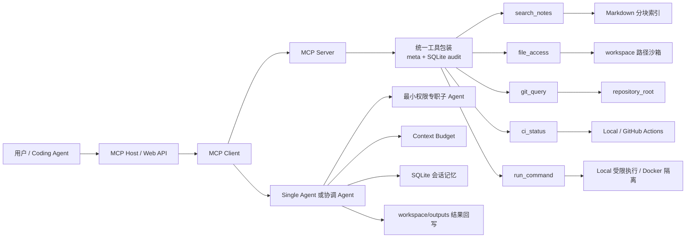

# Personal Knowledge MCP

一个面向 Agent 工程学习与面试演示的 MCP Server：把本地笔记检索、受控文件读写、
Git 查询、CI 状态和受限命令执行封装为 5 个可发现工具，并提供上下文预算、
Verification Loop、工具审计、单 Agent 自主工具模式、最小权限多 Agent 委派和可复现评测。
Agent 问答还提供基于本地 SQLite 的多轮会话记忆。

项目重点是 **MCP 工具契约、安全边界、验证与可观测性**，不是完整复刻 Codex。项目不会把
离线的检索→总结回退流程冒充真实模型委派。真实能力和已知限制见
[docs/LIMITATIONS.md](docs/LIMITATIONS.md)。

## 要解决的问题

Coding Agent 需要访问本地知识与工程系统，但直接给模型文件系统、Git、网络和进程权限，
会让权限、错误、重试和审计散落在 Prompt 中。本项目把能力收口到稳定工具契约：

- Agent 只提交结构化参数，服务端执行路径、命令和权限检查。
- 每次调用返回 `{ok,data,error,meta}`，并把失败分成 parameter、permission、
  conflict、timeout、transient、internal。
- “调用没有抛异常”不是完成；工具还要验证业务后置条件。
- 工具调用与任务 Trace 写入本地 SQLite，参数经过脱敏。

## 架构



核心分层：`server.py` 协议与审计包装；`services.py` 五工具业务；
`security.py` 边界；`verification.py` 验证/分类/重试/回退；
`index.py` 增量笔记索引；`agent.py` 编排；`telemetry.py` Trace。

## 五个工具

完整入参、Schema、annotations、错误码和重试语义见自动生成的
[docs/TOOLS.md](docs/TOOLS.md)。

| 工具 | 能力 | 关键边界 |
| --- | --- | --- |
| `search_notes` | Markdown 标题分块、中文 bigram、排序与证据行号 | 笔记只读；命中重新对照原文 |
| `file_access` | list/read/write/replace、SHA 乐观锁 | workspace 内相对路径；原子写、备份、回滚 |
| `git_query` | status/branch/log/diff | repository_root 内只读，结构化输出 |
| `ci_status` | 本地记录或 GitHub Actions | 精确 HTTP 分类；瞬时失败回退 local stale |
| `run_command` | 白名单命令 | 最小环境、参数策略、超时/输出上限；可选 Docker |

## 上下文与 Agent

- `full`：命中文档完整内容，作为高成本基线，仍受总预算限制。
- `relevant`：按相关性选择最高分 Markdown chunk。
- `summary`：在 relevant 基础上压缩长块；无模型时用抽取式摘要。

`delegated` 在连接支持 function calling 的 Provider 后是真实的协调器委派模式。协调 Agent
只看到 `delegate_knowledge/files/git/ci/command` 五个委派函数，不直接看到 MCP 工具；被选中的
专职子 Agent 再通过 MCP `tools/list` 发现自己获授权的工具。知识、文件、Git、CI、命令子 Agent
分别只能使用 `search_notes`、`file_access`、`git_query`、`ci_status`、`run_command`。复杂任务
可以顺序委派多个子 Agent，协调器最后汇总结果。无 Provider 时保留原固定检索→上下文→总结→
回写链作为离线演示，并在前端明确标注，不声称发生了模型动态委派。

`single` 是真实模型驱动的自主工具模式：把 MCP `tools/list` 转成 function definitions，
由支持工具调用的 Provider 在 5 个工具中选择，实际执行仍经过 MCP Client。该模式最多进行
6 轮模型—工具交互，但当前不设置应用层累计 token 上限。`max_tokens` 是每次注入证据或
工具结果的**上下文预算**，不是供应商总 token、费用或模型输出上限。

知识子 Agent 每个任务最多实际调用 `search_notes` 3 次；超过上限的第 4 次请求会以结构化
`tool_call_limit_exceeded` 返回，不再访问工具。多次检索得到的证据按 `path:line` 去重后才注入
上下文，减少重复 token。执行链路可展开查看每次查询词、`top_k`、去重数量、实际注入文本、
上下文 token 估算和是否裁剪。

引用校验只针对本轮调用过 `search_notes` 的知识回答。校验按实质性段落或列表项统计：每条结论
必须引用本轮真实 `path:line`，或者明确写“无证据”；结果返回 `citation_coverage`。这是结构覆盖
校验，不会自动证明引用内容在语义上完全支持结论。本地无 Key 模式是确定性演示，不冒充真实
模型效果。

### 多轮会话记忆

Web 为每个对话生成 `conversation_id`，将用户问题和最终回答写入
`.runtime/traces.sqlite3`。下一轮执行前，后端按时间读取最近消息，再在最多 1200 tokens 且
不超过当前 `max_tokens` 的记忆预算内优先保留最新内容。single 模式把历史直接放入模型消息；
delegated 模式只把历史交给协调 Agent，由它生成最小必要子任务，避免把整段对话扩散给所有
子 Agent。离线问答会把历史用于检索查询。前端提供“新对话”和“清空记忆”。

记忆只保存用户问题和 Agent 最终回答，不保存工具原始结果、系统提示词或 API Key。每个会话
最多保留 50 条消息；这是本地最近对话记忆，不是向量化长期记忆或跨对话用户画像。

Web 的“Agent 问答”页面可切换“多 Agent 委派”和“自主工具”。自主工具模式读取
`docs/prompts/agent-system.md` 作为系统提示词；委派模式由协调器拆解任务，子 Agent 各自执行
工具循环。两种模式都在代码层限制权限和失败后的无意义原样重试；知识回答还限制检索次数、
去重证据并执行逐结论引用覆盖校验。

## Verification Loop

```text
执行 → 验证后置条件 → 失败分类 → retry / fallback → 记录 attempt
```

工具内部只重试 retryable 的 timeout/transient，使用指数退避、随机抖动与总截止时间。
parameter/permission/conflict 不原样重试；run_command 不自动重试。文件写前把快照放在
`.runtime/backups`，验证失败回滚；GitHub 暂时不可用时回退本地 CI 并标 `stale=true`。
这套循环验证的是工具后置条件，不代表 Agent 会自动修复所有业务失败。

`ci_status(source="local")` 只发现 `.github/workflows/*.yml` 并读取可选的
`.ci/status.json`；它不会执行 GitHub Actions、pytest 或前端构建。没有本地状态记录时
返回 `state="unknown"`，不等于 CI 失败。真实 GitHub 运行需使用 `source="github"` 和
`owner/name`，并按仓库可见性配置 `GITHUB_TOKEN`。

## 快速开始

要求 Python 3.11+、[uv](https://docs.astral.sh/uv/)；MCP SDK 锁定 2.0.1。

```powershell
uv sync --extra dev --locked
uv run knowledge-mcp
```

默认地址：

- MCP：`http://127.0.0.1:8000/mcp`
- 健康检查：`http://127.0.0.1:8000/health`
- Web 控制台：`http://127.0.0.1:8000/`

stdio：

```powershell
$env:MCP_TRANSPORT = "stdio"
uv run knowledge-mcp
```

测试与文档一致性：

```powershell
uv run ruff check src tests scripts
uv run pytest
uv run python scripts/generate_tools_doc.py --check
uv run knowledge-mcp-eval --mode delegated --strategy relevant
```

## Claude Code / Cursor

仓库提供 `.mcp.json` 与 `.cursor/mcp.json`。从仓库根目录启动 Host，确保已安装 uv；
配置使用 stdio，不占用 HTTP 端口。Claude/Cursor 规范位于 `CLAUDE.md`、
`AGENTS.md`、`.claude/skills` 和 `.cursor/rules`。

示例任务：

> 调用 search_notes 查询“为什么要做失败分类”，保留引用；再读取
> workspace/examples/coding-agent-demo.md，并把最终回答写入 workspace/outputs。

## 命令执行安全

本地模式是“受限执行”，不是强沙箱：只传最小环境，Python 禁止 `-c/-m` 且只能运行
workspace 内 `.py`，Git 只允许 status/log/diff/show/branch/rev-parse，超时终止进程树，
输出按读取过程截断。file_access 仍可写脚本再执行，因此同用户本地模式不能抵御恶意代码。

设置 `MCP_SANDBOX=docker` 后使用 `--network none`、非 root、只挂载 workspace、
只读根文件系统及 CPU/内存/进程数限制，才提供更强隔离。

## 评测

`eval/tasks.jsonl` 包含 30 条中文问答、跨文档、Git/CI/文件/命令与故意失败用例。
评测复制 workspace 到临时目录，不污染演示文件。成功要求是要点命中达到阈值且引用合法，
不是“检索非空”。最新结果见 [docs/EVAL.md](docs/EVAL.md)；原始报告在本机
`reports/*.json`，默认不提交。没有真实模型 Key 的报告会明确标为不可写入简历。

配置支持工具调用的 Provider 后，评测器会按 `--mode single|delegated` 分别执行真实的
`ToolCallingAgent` 或 `DelegatedAgent`；不再只写模式标签。未配置 Provider 时只允许 delegated
离线回归，`--mode single` 会明确失败。修复前生成的历史报告仍不能用于比较两种编排模式，
需要在相同 Provider、模型、任务集、预算和策略下重新运行后才能比较。

## 配置与文档

配置样例见 `.env.example`，真实 `.env` 不提交。服务端 LLM 支持
`LLM_PROVIDER/LLM_MODEL/LLM_BASE_URL/LLM_API_KEY`；Key 不返回前端、不写 Trace。
Web 控制台也可以把供应商配置保存到本机：在 Windows 上，API Key 使用当前用户的 DPAPI
加密后写入已被 Git 忽略的 `.private/provider-config.json`，刷新页面和重启服务后无需
重新输入；密文不能被其他 Windows 用户或其他电脑解密。非 Windows 平台当前不支持持久化
Key，只能使用环境变量或单次内存配置。

- [API 与 SSE](docs/API.md)
- [设计取舍](docs/DESIGN.md)
- [架构细节](docs/ARCHITECTURE.md)
- [学习指南](docs/LEARNING_GUIDE.md)
- [能力边界与已知限制](docs/LIMITATIONS.md)
- [委派模式功能报告](docs/DELEGATION_REPORT.md)
- [会话记忆功能报告](docs/MEMORY_REPORT.md)
- [演示步骤](docs/demo/README.md)

## 真实性边界

该仓库能证明五个 MCP 工具、Client 调用链、验证回路、权限/超时/重试、上下文策略、
最小权限多 Agent 委派、单 Agent 自主工具循环、本地多轮会话和评测管线。它不能证明生产级
通用 Agent、向量 RAG、跨对话语义长期记忆或任意代码的安全执行。真实模型的准确率、token 与延迟只能引用具体
`reports/*.json`；未运行真实模型时，不在简历中编造提升比例。
