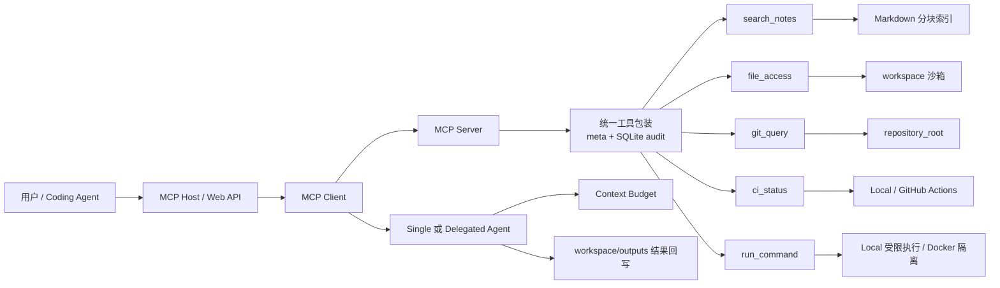

# Personal Knowledge MCP

一个面向 Agent 工程学习与面试演示的 MCP Server：把本地笔记检索、受控文件读写、
Git 查询、CI 状态和受限命令执行封装为 5 个可发现工具，并提供上下文预算、
Verification Loop、工具审计、单 Agent/委派模式和可复现评测。

## 要解决的问题

Coding Agent 需要访问本地知识与工程系统，但直接给模型文件系统、Git、网络和进程权限，
会让权限、错误、重试和审计散落在 Prompt 中。本项目把能力收口到稳定工具契约：

- Agent 只提交结构化参数，服务端执行路径、命令和权限检查。
- 每次调用返回 `{ok,data,error,meta}`，并把失败分成 parameter、permission、
  conflict、timeout、transient、internal。
- “调用没有抛异常”不是完成；工具还要验证业务后置条件。
- 工具调用与任务 Trace 写入本地 SQLite，参数经过脱敏。

## 架构



核心分层：`server.py` 协议与审计包装；`services.py` 五工具业务；
`security.py` 边界；`verification.py` 验证/分类/重试/回退；
`index.py` 增量笔记索引；`agent.py` 编排；`telemetry.py` Trace。

## 五个工具

完整入参、Schema、annotations、错误码和重试语义见自动生成的
[docs/TOOLS.md](docs/TOOLS.md)。

| 工具 | 能力 | 关键边界 |
| --- | --- | --- |
| `search_notes` | Markdown 标题分块、中文 bigram、排序与证据行号 | 笔记只读；命中重新对照原文 |
| `file_access` | list/read/write/replace、SHA 乐观锁 | workspace 内相对路径；原子写、备份、回滚 |
| `git_query` | status/branch/log/diff | repository_root 内只读，结构化输出 |
| `ci_status` | 本地记录或 GitHub Actions | 精确 HTTP 分类；瞬时失败回退 local stale |
| `run_command` | 白名单命令 | 最小环境、参数策略、超时/输出上限；可选 Docker |

## 上下文与 Agent

- `full`：命中文档完整内容，作为高成本基线，仍受总预算限制。
- `relevant`：按相关性选择最高分 Markdown chunk。
- `summary`：在 relevant 基础上压缩长块；无模型时用抽取式摘要。

`delegated` 模式把检索与总结分开：检索子 Agent 只获取证据，总结子 Agent 没有工具。
`single` 模式在配置真实 Provider 时，把 MCP `tools/list` 转成 function definitions，
模型发起的调用仍由 MCP Client 执行。两种模式都限制预算和步骤，并校验最终引用。
本地无 Key 模式是确定性演示，不冒充真实模型效果。

## Verification Loop

```text
执行 → 验证后置条件 → 失败分类 → retry / fallback → 记录 attempt
```

只重试 retryable 的 timeout/transient，使用指数退避、随机抖动与总截止时间。
parameter/permission/conflict 不原样重试；run_command 默认不重试。文件写前把快照放在
`.runtime/backups`，验证失败回滚；GitHub 暂时不可用时回退本地 CI 并标 `stale=true`。

## 快速开始

要求 Python 3.11+、[uv](https://docs.astral.sh/uv/)；MCP SDK 锁定 2.0.1。

```powershell
uv sync --extra dev --locked
uv run knowledge-mcp
```

默认地址：

- MCP：`http://127.0.0.1:8000/mcp`
- 健康检查：`http://127.0.0.1:8000/health`
- Web 控制台：`http://127.0.0.1:8000/`

stdio：

```powershell
$env:MCP_TRANSPORT = "stdio"
uv run knowledge-mcp
```

测试与文档一致性：

```powershell
uv run ruff check src tests scripts
uv run pytest
uv run python scripts/generate_tools_doc.py --check
uv run knowledge-mcp-eval --mode delegated --strategy relevant
```

## Claude Code / Cursor

仓库提供 `.mcp.json` 与 `.cursor/mcp.json`。从仓库根目录启动 Host，确保已安装 uv；
配置使用 stdio，不占用 HTTP 端口。Claude/Cursor 规范位于 `CLAUDE.md`、
`AGENTS.md`、`.claude/skills` 和 `.cursor/rules`。

示例任务：

> 调用 search_notes 查询“为什么要做失败分类”，保留引用；再读取
> workspace/examples/coding-agent-demo.md，并把最终回答写入 workspace/outputs。

## 命令执行安全

本地模式是“受限执行”，不是强沙箱：只传最小环境，Python 禁止 `-c/-m` 且只能运行
workspace 内 `.py`，Git 只允许 status/log/diff/show/branch/rev-parse，超时终止进程树，
输出按读取过程截断。file_access 仍可写脚本再执行，因此同用户本地模式不能抵御恶意代码。

设置 `MCP_SANDBOX=docker` 后使用 `--network none`、非 root、只挂载 workspace、
只读根文件系统及 CPU/内存/进程数限制，才提供更强隔离。

## 评测

`eval/tasks.jsonl` 包含 30 条中文问答、跨文档、Git/CI/文件/命令与故意失败用例。
评测复制 workspace 到临时目录，不污染演示文件。成功要求是要点命中达到阈值且引用合法，
不是“检索非空”。最新结果见 [docs/EVAL.md](docs/EVAL.md)；原始报告在本机
`reports/*.json`，默认不提交。没有真实模型 Key 的报告会明确标为不可写入简历。

## 配置与文档

配置样例见 `.env.example`，真实 `.env` 不提交。服务端 LLM 支持
`LLM_PROVIDER/LLM_MODEL/LLM_BASE_URL/LLM_API_KEY`；Key 不返回前端、不写 Trace。

- [API 与 SSE](docs/API.md)
- [设计取舍](docs/DESIGN.md)
- [架构细节](docs/ARCHITECTURE.md)
- [学习指南](docs/LEARNING_GUIDE.md)
- [演示步骤](docs/demo/README.md)

## 真实性边界

该仓库能证明五个 MCP 工具、Client 调用链、验证回路、权限/超时/重试、上下文策略、
单 Agent/委派骨架和评测管线。真实模型的准确率、token 与延迟只能引用具体
`reports/*.json`；未运行真实模型时，不在简历中编造提升比例。
